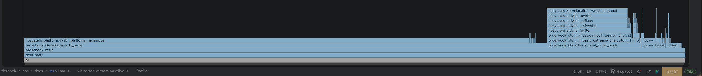

# v1: sorted vectors baseline

The simplest working version: two sorted `std::vector<Order>`, one for bids and one for asks.

## Design

- Prices are integer cents.
- Bids are sorted ascending and asks descending, so the best price of each side is at the back. Matching only looks at `back()`.
- A new order is placed with `std::lower_bound`, so it goes in front of equal-priced orders and the older order stays nearer the back (time priority).
- Trades execute at the resting order's price. Leftover quantity rests in the book.

## Results (Release build)

| Orders | Time | Orders/sec |
|---:|---:|---:|
| 100,000 | 0.0148 s | ~6.75 M |
| 1,000,000 | 1.328 s | ~753 K |
| 10,000,000 | 139.9 s | ~71.5 K |

10x more orders took about 90x longer (100K to 1M) and about 105x longer (1M to 10M). That is roughly quadratic growth.

## Profile

About three quarters of the profiled run is `memmove` inside `add_order`, which is the vector shifting elements on every insert and erase. The matching logic is a small fraction.

## Why it is slow

Each resting order is inserted into the middle of a sorted vector, and every element after it is shifted. The cost of one insert grows with the number of resting orders, and the number of resting orders grows with the input, so total time grows roughly with the square of the input size.

## What v2 and v3 target

- v2: cancels and modifies, with a lookup by order ID.
- v3: price-indexed levels, a linked list per level, and a memory pool, so insert and cancel are O(1) and the scaling curve flattens.
